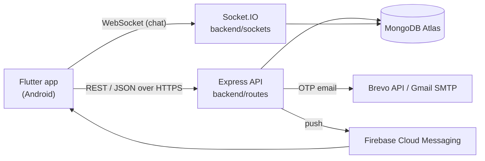

# EcoQuest

A gamified Android app that turns everyday eco-friendly actions in Ebetsu City into quests. Players complete a quest, prove it with a photo, and get points, XP and an estimated CO₂e saving right away. Other players see the post in a community feed, and anyone can report a photo that does not show the quest.

Detailed design notes (in Thai) are in `PROJECT_CONTEXT.md`. Quest data and CO₂e sources are in `Quest_list.md` and `CO2_RESEARCH.md`, and the reward balance study is in `BALANCE_REPORT.md`.

## Tech stack

| Part | What is used |
|---|---|
| App | Flutter (Dart 3.11) for Android, `provider` for state, `http` for REST, `socket_io_client` for chat, `shared_preferences` for the saved session, `image_picker` for proof photos, `mobile_scanner` / `qr_flutter` for event check-in, `firebase_messaging` for push |
| Backend | Node.js, Express 4, Socket.IO 4, Mongoose 8, `jsonwebtoken`, `bcryptjs`, `nodemailer`, `firebase-admin` |
| Database | MongoDB Atlas (free tier, 512 MB). Photos are stored as binary data inside the documents |
| Email | One-time codes (OTP) are sent with the Brevo email API on Render (Render blocks SMTP), or with Gmail SMTP when the server runs locally |
| Push | Firebase Cloud Messaging. Firebase is used only for push; all data stays in MongoDB |
| Hosting | Render free web service (`render.yaml`) |



All game rules (rewards, combos, streaks, medals, Eco Bingo, CO₂e) are calculated on the server. The app only shows the results, so a player cannot change them on the phone.

## How the app works, start to finish

### 1. Opening the app and signing in

- `SplashPage` checks the saved token and user in `shared_preferences` (`StorageService`). With a session it opens the app at once and refreshes the profile in the background, because the free Render server can take 30–60 s to wake up.
- **Guest**: `POST /auth/guest` creates an account with no email. A guest can later upgrade to a real account (Settings).
- **Register**: `POST /auth/register` sends a 6-digit OTP by email. The account gets a token only after `POST /auth/verify-email`, so nobody can sign up with someone else's email.
- **Login**: `POST /auth/login` returns a JWT (30 days) that the app sends as `Authorization: Bearer <token>`.
- **Forgot password**: OTP by email → a short-lived reset token → `POST /auth/reset-password`.
- Each JWT carries the account's `tokenVersion`. Changing or resetting the password increases it, so every older token (on other phones) stops working (`utils/verifyToken.js`).
- OTPs are random, stored only as a bcrypt hash, expire after 10 minutes and are cancelled after 5 wrong tries. Login, OTP, sign-up and upload routes are rate-limited (`utils/rateLimit.js`).

### 2. Finding and completing a quest

1. **Explore** lists the active quests (`GET /quests`). The 21 quests are seeded from `backend/scripts/seedQuests.js` every time the server starts.
2. The player starts a quest (`POST /quests/:id/start`), does the real activity, and takes a photo in the proof sheet. Some quests also ask a short form (for example, how many containers were returned).
3. `POST /quests/:id/complete` sends the photo as base64. The server checks that it really is a JPEG or PNG (`utils/imageUpload.js`) and that this player has not used the same photo before (SHA-256 hash).
4. The reward is given immediately (`utils/submissions.js` → `utils/questRewards.js`):
   - base points and XP of the quest, plus upgrades,
   - **Daily Variety Combo**: a different quest on the same day multiplies the reward (up to ×1.5); repeating the same quest lowers it (down to ×0.25) (`utils/combo.js`),
   - **Daily Streak** milestones (`utils/streak.js`), **medals** (`utils/achievements.js`), **Eco Bingo** lines (`utils/bingo.js`), level from XP (`utils/progression.js`),
   - estimated CO₂e, counted at most once per quest per day.
5. The app plays the reward animation, and a notification is saved (and pushed).

Multi-day **Food Saver** quests (1, 3, 7 days) need one photo check-in per day and give a finish bonus on the last day. The "Check your fridge" quest needs no photo; it checks that the player saved a new fridge item.

### 3. Community feed, reporting and moderation

- Every completed quest with a photo appears in **Today's quests** (`GET /feed`), where other players can cheer. The feed shows only today's posts (Japan time), and old photos are deleted to save database space.
- Photo URLs are signed with an HMAC (`utils/photoSign.js`), so photos cannot be opened by guessing IDs.
- A registered player can report a post with a reason. After 3 reports the post is hidden until an admin reviews it.
- The admin (`/reviews`) can keep the post, remove the photo, or remove it and take back the points/XP/CO₂e from everyone who got them. Removals can be **restored within 7 days** from "Recently removed".

### 4. Playing with others

- **Friends**: search by name, send/accept requests (`/friends`).
- **Chat**: party and friend chat over Socket.IO (`backend/sockets/index.js`). The socket uses the same JWT. Messages are limited to 1,000 characters and 10 messages per 10 seconds.
- **Party events**: a leader creates a room from a party quest with a date, place and capacity. Members join; on the event day the leader starts it, and after 15 minutes completes it with one group photo. Every member is rewarded (`/party`, `utils/partyGate.js`).

### 5. Organization events

1. A user with a verified email applies to become an organization (confirmed by OTP). The admin approves, rejects or later suspends it (`/org/admin/...`).
2. An approved organization creates events (10–40 points, 15 min to 8 h, up to 60 days ahead). Each event gets a hidden quest so the normal reward code is reused.
3. Players find events under the **Event** filter and register.
4. At the event, the organization shows a QR code that changes every 30 seconds (event ID + HMAC of the time window, `utils/orgQr.js`). Players scan it (`POST /org/checkin`) and get the points at once.

### 6. Smart Fridge, impact and profile

- **Smart Fridge** (`/fridge-items`): save food with an expiry date and an optional photo. The server sends reminders before and after expiry; photos of expired items are deleted.
- **Ebetsu's impact** (`/impact/summary`): the total CO₂e saved by all players, the weekly total, a cedar-tree comparison and the number of containers returned.
- **Profile**: level, XP, points, streak, medals, avatar and cosmetics.

### 7. Notifications

Every notification is saved in the `notifications` collection and shown on the Notifications page (`utils/notifications.js`). It is also sent as a push through FCM (`utils/push.js`) to up to 10 phones per account. The phone registers its Firebase Installation ID after sign-in (`PushService`) and removes it on sign-out. Fridge items are checked when the server starts and every 30 minutes while it is awake.

### 8. Admin

Admins are the emails in `ADMIN_EMAILS`. Signing in is not enough: the admin must also enter an email OTP, which gives a 12-hour admin token kept only in app memory and sent as the `X-Admin-Token` header (`middleware/admin.js`). Admin pages: reported posts, recently removed posts, organization requests, and testing tools.

## Project structure

```
lib/                          Flutter app
  main.dart                   app start and providers (Firebase is started in services/push_service.dart)
  routes/app_routes.dart      named routes
  pages/                      one folder per screen group:
                              auth, home, explore, progress, community, party, org,
                              inventory (camera, fridge, badges), profile, settings,
                              notification, bingo, admin, shop (hidden by feature flag)
  providers/                  state (ChangeNotifier) used by the pages
  services/                   API calls (one per backend area), socket, push, local storage
  models/                     JSON → Dart classes
  widgets/                    shared UI (bottom nav, proof sheet, toasts, cards, animations)
  utils/constants.dart        API base URL and storage keys

backend/                      Node.js API
  server.js                   Express app, routes, Socket.IO, start-up jobs
  routes/                     one file per area: auth, quests, submissions, feed, reviews,
                              party, friends, chat, fridgeItems, org, impact, bingo,
                              achievements, notifications, users, upgrades, inventory, admin
  models/                     Mongoose schemas (17 collections)
  middleware/                 auth.js (JWT), admin.js (admin allowlist + 2FA)
  sockets/index.js            real-time chat
  utils/                      game rules and helpers (rewards, combo, streak, medals, bingo,
                              CO₂e, OTP, mail, push, rate limit, image checks, photo signing)
  scripts/seedQuests.js       quest list, upserted on every start
```

## Running it

### Backend

```bash
cd backend
npm install
cp .env.example .env   # then fill in the values
npm run dev            # or: npm start
```

| Variable | Required | Purpose |
|---|---|---|
| `MONGODB_URI` | yes | MongoDB Atlas connection string |
| `JWT_SECRET` | yes | Secret for login tokens, OTP reset tokens, photo URLs and event QR codes. Changing it signs everyone out and breaks old photo links |
| `GMAIL_USER`, `GMAIL_APP_PASSWORD` | for email | Sender address, and a Gmail App Password for local SMTP |
| `BREVO_API_KEY` | on Render | Brevo API key. When set, email goes through Brevo instead of SMTP. `GMAIL_USER` must be a verified sender in Brevo |
| `ADMIN_EMAILS` | no | Comma-separated emails that can open the admin tools. Empty = admin off |
| `FIREBASE_SERVICE_ACCOUNT` | for push | Firebase service account JSON (raw or base64). Not set = no push; in-app notifications still work |
| `PORT` | no | Defaults to 5000 |

To get `FIREBASE_SERVICE_ACCOUNT`, go to Firebase Console → Project settings → Service accounts → **Generate new private key**, and paste the whole JSON as the value. **Never commit this file.** `*firebase-adminsdk*.json` is gitignored.

### App

```bash
flutter pub get
flutter run                                                     # uses the deployed Render API
flutter run --dart-define=API_BASE_URL=http://10.0.2.2:5000/api # local backend from the Android emulator
```

The deployed API URL is `_deployedApiUrl` in `lib/utils/constants.dart`. It must end with `/api`. Push needs `android/app/google-services.json` from the same Firebase project as the backend's service account (already in the repo).

### Deploy (Render)

1. Render Dashboard → New → Blueprint → choose this repo (`render.yaml`).
2. In the service's Environment page set `MONGODB_URI`, `JWT_SECRET`, `GMAIL_USER`, `BREVO_API_KEY`, `ADMIN_EMAILS` and `FIREBASE_SERVICE_ACCOUNT`.
3. In MongoDB Atlas → Network Access, allow `0.0.0.0/0` (Render has no fixed IP).

On the free tier the service sleeps after about 15 minutes without requests. The first request after that is slow, and the 30-minute fridge check does not run while it sleeps.
